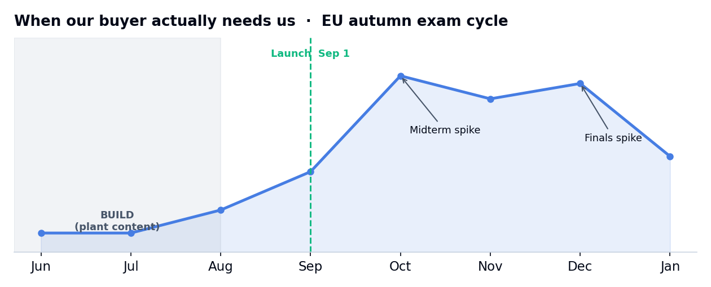
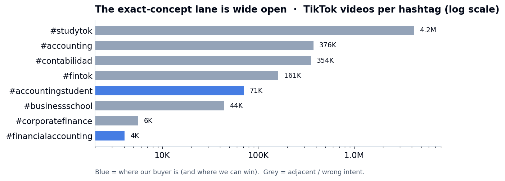

# CMO weekly report — 2026-W23

_Week of Mon 2026-06-01 → Sun 2026-06-07 · for Hoang · data: research and live scans only (the brief is still on fixtures until the /api/v1 token exists)_

Hoang — short version: we spent this week getting our bearings, and the picture is encouraging. We
now know exactly who we are talking to, when they will need us, and where the gap is that nobody else
is filling. Nothing is live yet, so there are no audience numbers to report — but the groundwork that
makes October pay off is the work of June, and that is well under way. The one thing on my mind: the
clock. Every week we wait to start filming is a week off the runway we need before the exam panic
hits.

## Where the plan stands
We are selling exam calm to anxious business undergraduates, and we launch on September 1. The whole
game is timing. Our buyer barely exists in the summer, appears in force when midterms hit in late
October, and again at finals in December. So the plan is simple to say and hard to do: build the
content now, while no one is watching, so we already rank and already have an audience the moment they
start searching in a panic.

Three pillars carry it, and I think they are right: **Worked, Not Watched** (you solving a real exam
problem on screen — our product, filmed), **The Concept You Will Be Tested On** (a concept a week,
timed to the exam waves), and **What AI Gets Wrong** (the honest case that ChatGPT can hand you an
answer but cannot watch you try). The brand and the engine are locked; the strategy itself is still a
proposal until you make the five calls at the bottom.

## How last week went
No channel metrics — we have posted nothing, by design. What we did instead was the homework that
makes the rest cheaper: I read the company inside out, ran live research on how these students study
and where they look, and scanned the competition directly on TikTok. That last one is the most useful
thing I can show you this week.

Read that chart as our whole thesis in one picture. The broad study tags are enormous and generic;
the exact concept we teach — financial accounting — has about four thousand videos against four
million on the general study tag. The lane is almost empty, and the few people in it are teaching US
professionals, not European undergraduates the night before an exam. That is the room we walk into.
On the build side: the brand pack is done, the report-and-feedback machinery you are reading is built,
and the only thing not started is filming — which is the long pole, and the thing I most want your go
on.

## What I want to do next week
I want to stop preparing and start making. Concretely: get your five decisions so the strategy turns
from proposal into commitment, pick the one or two exams we lead with (my instinct is the cash-flow
statement and T-accounts — highest pain, highest search), and if your screen-recording setup is
ready, film the first two worked examples. **No tweak to the plan yet** — there is no performance data
to tweak against. The first real course-correction comes when content is live or the data token
lands; until then the plan stands as written.

## Ideas for the product
Nothing live yet — the feature-request engine runs on real customer signal (demand-gaps and feedback
from the brief), which is still fixtures pre-launch. There is one worked example on file, REQ-0001
(free concept pages for SEO and lead capture), parked as a format demo. If you like the idea, say so
and I will turn it into a live request.

## What I need from you
- [ ] **Channels** — confirm YouTube primary, TikTok and Reels as the net, Reddit and Discord light, LinkedIn later.
- [ ] **The trademark trade-off** — agree we stay strictly topic-led, giving up the branded-exam hook for safety and independence.
- [ ] **Cadence** — the honest number of pieces a week you can sustain through the build.
- [ ] **Lead courses** — which one or two exams we build the first worked examples around.
- [ ] **Filming setup** — ready to go, or a gap to close before we film.
- [ ] **Scheduling** — wire the local weekly job, or keep the cycle on-demand.
- [ ] **REQ-0001** — promote the concept-pages idea to a live request, or leave it as an example.
